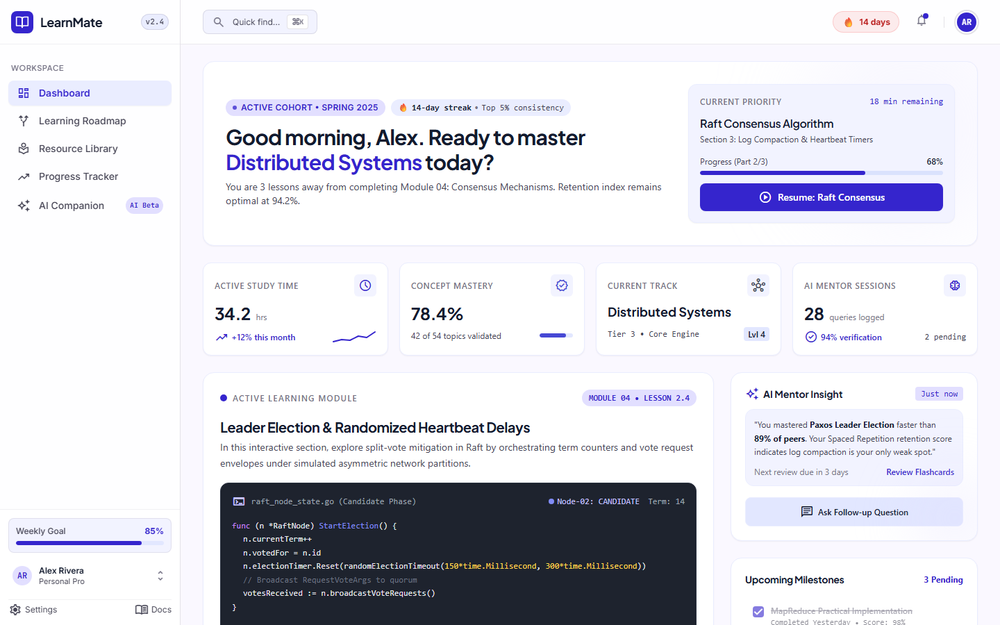
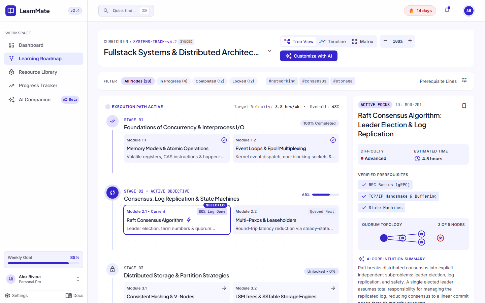
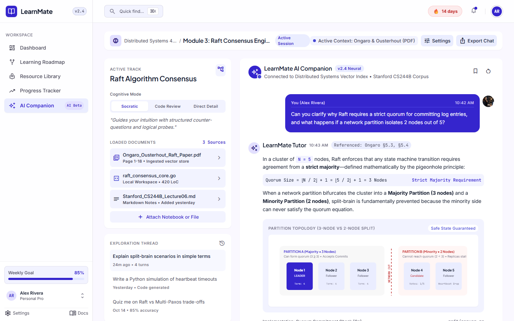
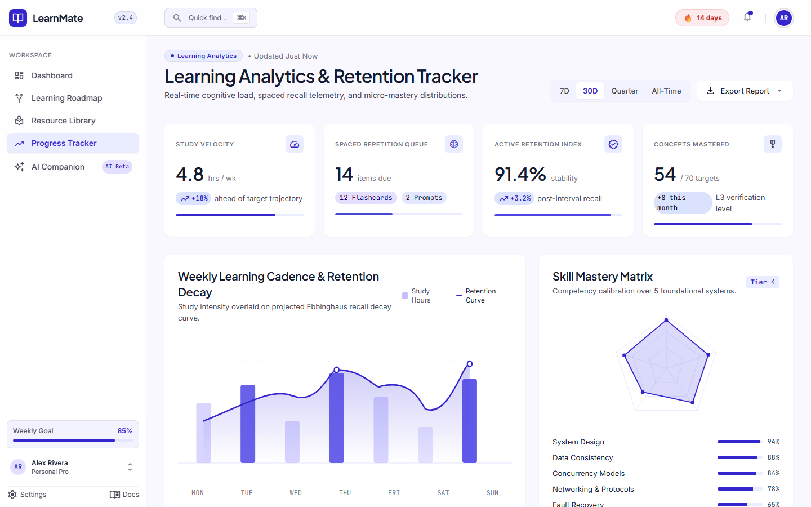
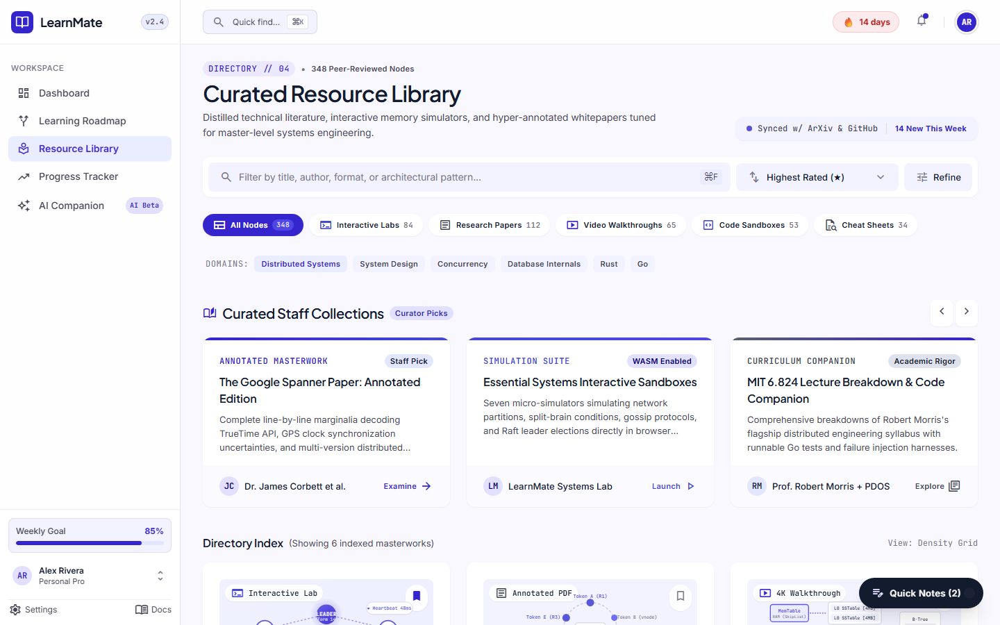
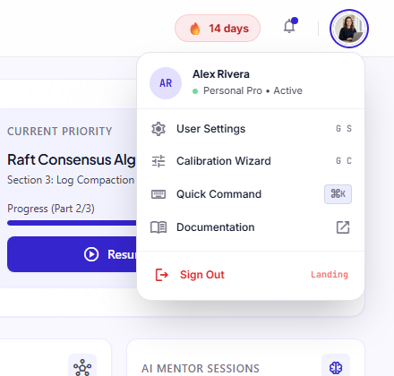

<div align="center">

# 🎓 LearnMate AI

### Agentic AI-Powered Personalized Course Pathways Platform

*An intelligent, adaptive learning ecosystem that dynamically builds, monitors, and optimizes personalized engineering curricula — powered by **IBM Granite 3.0** and **watsonx.ai**.*

[](https://learnmate-ai-skn.vercel.app/)
[](https://skillsbuild.org)
[](https://edunetfoundation.org)
[](https://python.org)
[](https://fastapi.tiangolo.com)
[](https://react.dev)
[](https://typescriptlang.org)
[](https://tailwindcss.com)
[](backend/tests)
[](LICENSE)

<br/>

### 🌐 **[Explore the Live Web Platform → https://learnmate-ai-skn.vercel.app](https://learnmate-ai-skn.vercel.app)**

</div>

---

> ### 📌 Capstone Project Context & Problem Statement
> **Edunet Foundation / IBM SkillsBuild Internship**  
> **Problem Statement No. 12 — Agentic AI for Personalized Course Pathways**  
> 
> * **The Challenge:** Students frequently struggle to identify the right learning pathways aligning with their current proficiencies, target careers, and long-term goals due to fragmented online tutorials, information overload, and a lack of personalized mentoring.
> * **The LearnMate AI Solution:** An autonomous Agentic AI coach that evaluates current skills, audits deficits against enterprise engineering roles, dynamically generates milestone-based roadmaps, continuously adapts paths based on progress and feedback, and provides real-time Socratic debugging.
> * **Mandatory Technology:** Powered by **IBM Granite 3.0** and **IBM Cloud / watsonx.ai** services, with offline zero-dependency mock stubs for local evaluation without cloud quotas.

---

## 📸 Visual Showcase & Prototype Gallery

LearnMate AI features an enterprise-grade **"Modern Craft Editorial"** design system migrated directly from high-fidelity **Stitch prototypes** (Electric Indigo `#4F46E5`, Porcelain Surface `#FAF8FF`, Plus Jakarta Sans headlines, and JetBrains Mono code chips).

<div align="center">

### Executive Learner Dashboard (`/dashboard`)
*Live Go code execution sandbox, weekly study cadence, retention decay tracking, and active Raft consensus modules.*


<br/><br/>

### Adaptive Learning Roadmap (`/pathway`)
*4-stage visual execution DAG, pulsing active states, node inspector flyout, and dynamic SVG Quorum Topology diagrams.*


<br/><br/>

### Socratic AI Companion (`/companion`)
*Split-screen Socratic debugger, active research paper grounding, mathematical quorum proofs, and network partition diagrams.*


<br/><br/>

### Progress & Cognitive Retention Tracker (`/progress`)
*Continuous Ebbinghaus memory decay curves, 5-axis competency radar charts, and FSRS-4.5 spaced repetition queues.*


<br/><br/>

### Curated Resource Library (`/resources`)
*Staff collections, interactive system design labs, research papers, and technical books synchronized with IBM Granite.*


<br/><br/>

### Header Profile & Settings Dropdown
*Accessible user status drawer, calibration wizard shortcut, global `⌘K` palette trigger, and clean session teardown.*


</div>

---

## 🌟 The 10 Migrated Prototype Screens

| # | Screen | Route | Key Capabilities & Technical Highlights |
|---|---|---|---|
| **01** | **Landing Page** | `/` & `/landing` | Hero value proposition, live Go consensus preview terminal, 3 architectural pillar cards, dual conversion CTAs. |
| **02** | **Sign Up & Track Selection** | `/signup` | GitHub Enterprise / Google SSO, real-time password entropy meter (4-stage status), 3 primary engineering tracks. |
| **03** | **4-Step Calibration Protocol** | `/onboarding` | Stepper calibration: Target role, baseline skills, modal preferences (sandboxes/papers), and weekly commitment slider. |
| **04** | **Learner Dashboard** | `/dashboard` | 4 executive KPI cards, 8-column Go sandbox (`raft_election.go`), curated micro-lessons, weekly rhythm heatmap. |
| **05** | **Learning Pathway Roadmap** | `/pathway` | 4 progressive stages (Foundations → Consensus → Fault-Tolerance → Production), live Node Inspector, Quorum SVG diagram, natural language pathway adaptation. |
| **06** | **Skill Gap Matrix** | `/skills` | Role deficit breakdown (High/Medium/Low priority), IBM Granite diagnostic rationales, interactive 5-axis SVG competency radar. |
| **07** | **Curated Resource Library** | `/resources` | Staff Collections carousel (Google Spanner OSDI '12, MIT 6.824), format filter pills (Labs, Papers, Videos), difficulty tags. |
| **08** | **Progress & Retention Tracker** | `/progress` | Weekly study velocity, continuous Ebbinghaus retention decay curve, active streak (`🔥 14 days`), spaced repetition flashcard queue. |
| **09** | **AI Learning Companion** | `/companion` | 3 cognitive modes (Socratic, Direct Architect, Exam Prep), loaded source papers, visual split-brain network partition SVG diagram, live chat stream. |
| **10** | **Settings & Cognitive Calibration**| `/settings` | IBM Granite 3.0 8B Instruct vs Claude 3.5 Sonnet inference switcher, context window slider (16k–128k), FSRS-4.5 spaced repetition tuning. |
| **11** | **Global App Shell & Navigation**| *Global Shell* | 260px fixed craft sidebar, weekly goal progress bar (`85%`), top header with quick search, top-right user menu dropdown, and `⌘K` Command Palette. |

---

## 🏗️ Architecture & Agentic Data Flow

```
┌──────────────────────────────────────────────────────────────────────────────────┐
│                         Browser Client (React 18 + TypeScript)                   │
│          Vite · Tailwind CSS (Modern Craft Tokens) · Command Palette (⌘K)         │
│                                                                                  │
│  Landing │ Auth │ Onboarding │ Dashboard │ Pathway │ Skills │ Recs │ Chat │ Set  │
└────────────────────────────────────────┬─────────────────────────────────────────┘
                                         │  HTTP / JSON (Header: X-Session-ID)
                                         ▼
┌──────────────────────────────────────────────────────────────────────────────────┐
│                           FastAPI Backend (Port 8000)                            │
│                                                                                  │
│   Routers:   /session  ·  /skills  ·  /pathway  ·  /recommendations              │
│              /progress ·  /companion                                             │
│                                                                                  │
│   Services:  Granite-first service layer with session-scoped memory store        │
└────────────────────────────────────────┬─────────────────────────────────────────┘
                                         │
                    ┌────────────────────┴────────────────────┐
                    │ (If Langflow is configured)             │ (Default / Offline)
                    ▼                                         ▼
┌──────────────────────────────────────┐  ┌────────────────────────────────────────┐
│      Langflow Server (Port 7860)     │  │          granite_stub.py Fallback      │
│                                      │  │                                        │
│  6 Custom Agentic AI Workflows:      │  │  Zero-dependency Python fallback       │
│  • pathway-generation.json           │  │  Returns identical response schemas    │
│  • skill-gap-analysis.json           │  │  Role-aware, dynamic, zero API fees    │
│  • course-recommendations.json       │  │  Enables 100% offline development      │
│  • adaptive-update.json              │  └────────────────────────────────────────┘
│  • progress-summary.json             │
│  • learning-companion.json           │
└───────────────────┬──────────────────┘
                    │
         ┌──────────┴──────────┐
         ▼                     ▼
┌─────────────────┐   ┌────────────────────────────────────────────────────────────┐
│ GraniteStub.py  │   │ GraniteWatsonx.py (IBM watsonx.ai Enterprise)              │
│ (Mock Flow)     │   │ Model: ibm/granite-13b-chat-v2 / granite-3-8b-instruct     │
└─────────────────┘   └────────────────────────────────────────────────────────────┘
```

---

## 🛠️ Tech Stack

| Layer | Technologies | Purpose |
|---|---|---|
| **Frontend UI** | React 18, TypeScript 5.6, Vite 8, Tailwind CSS v3 | High-throughput SPA, static type-safety, rapid HMR |
| **Design System** | Modern Craft Editorial (Electric Indigo, Porcelain, Slate) | Custom Tailwind tokens mirroring Stitch prototypes |
| **Typography** | Plus Jakarta Sans, Inter, JetBrains Mono | Editorial headlines, readable body text, technical syntax |
| **Iconography** | Google Material Symbols Outlined | Pixel-perfect vector icons across all views |
| **Backend API** | Python 3.11, FastAPI, Uvicorn, Pydantic v2 | High-concurrency async REST API & input validation |
| **AI Orchestration**| Langflow & IBM Granite 3.0 / watsonx.ai | Agentic reasoning, gap auditing, roadmap synthesis |
| **Testing** | pytest, pytest-asyncio, puppeteer-core | Unit testing, integration auditing, headless browser screenshots |
| **DevOps** | Docker, Docker Compose | Multi-container orchestration (Frontend, Backend, Langflow) |

---

## 🚀 Getting Started

### Prerequisites
* **Python 3.11+** installed ([python.org](https://python.org))
* **Node.js 18+ or 20+ LTS** installed ([nodejs.org](https://nodejs.org))
* **Git** installed ([git-scm.com](https://git-scm.com))

> **💡 No IBM Cloud credits or Bobcoins required to run:** The built-in offline stub engine simulates IBM Granite 3.0 locally with role-aware logic and zero external dependencies.

---

### Step-by-Step Local Setup

#### 1. Clone the Repository
```bash
git clone https://github.com/sharatkumar-dev/learnmate-ai.git
cd learnmate-ai
```

#### 2. Backend Setup (FastAPI)
```bash
# Set up Python virtual environment
python -m venv venv

# On Windows:
.\venv\Scripts\activate
# On macOS / Linux:
# source venv/bin/activate

# Install dependencies
pip install -r backend/requirements.txt

# Start the FastAPI server
python -m uvicorn app.main:app --app-dir backend --reload --port 8000
```
* Backend API will be live at: **`http://127.0.0.1:8000`**
* Interactive Swagger Docs: **`http://127.0.0.1:8000/docs`**

#### 3. Frontend Setup (React + Vite)
```bash
# Open a new terminal
cd frontend

# Install node dependencies
npm install

# Start Vite development server
npm run dev
```
* Frontend application will be live at: **`http://localhost:5173`**

---

## ⚙️ Environment Configuration

Create a `.env` file in the root directory (or copy from `.env.example`):

```bash
cp .env.example .env
```

| Key | Default Value | Description |
|---|---|---|
| `LANGFLOW_BASE_URL` | `http://localhost:7860` | URL of the local Langflow server (optional) |
| `LANGFLOW_API_KEY` | *(empty)* | Optional API token for secured Langflow instances |
| `WATSONX_API_KEY` | *(empty)* | IBM Cloud API key for live watsonx.ai inference |
| `WATSONX_PROJECT_ID` | *(empty)* | IBM Cloud watsonx.ai Project ID |
| `WATSONX_URL` | `https://us-south.ml.cloud.ibm.com` | IBM Cloud regional service endpoint |
| `FLOW_ID_PATHWAY_GENERATION` | *(empty)* | Langflow flow UUID for pathway generation |
| `FLOW_ID_SKILL_GAP_ANALYSIS` | *(empty)* | Langflow flow UUID for gap analysis |
| `FLOW_ID_COURSE_RECOMMENDATIONS`| *(empty)* | Langflow flow UUID for resource curation |
| `FLOW_ID_ADAPTIVE_UPDATE` | *(empty)* | Langflow flow UUID for dynamic roadmap adaptation |
| `FLOW_ID_PROGRESS_SUMMARY` | *(empty)* | Langflow flow UUID for progress narratives |
| `FLOW_ID_LEARNING_COMPANION` | *(empty)* | Langflow flow UUID for Socratic chat companion |

---

## 🔗 REST API Specification

All protected endpoints require the `X-Session-ID` header obtained from `/api/session/start`.

| Method | Endpoint | Header | Payload | Description |
|---|---|---|---|---|
| `GET` | `/health` | — | — | Health check & service readiness |
| `POST` | `/api/session/start` | — | `{ "profile": { ... } }` | Initializes learner session & state |
| `GET` | `/api/session/{id}` | `X-Session-ID` | — | Retrieves aggregate learner session state |
| `POST` | `/api/skills/analyze` | `X-Session-ID` | `{ "current_skills": [...], "target_role": "..." }` | Audits skill gaps & priority ratings |
| `POST` | `/api/pathway/generate` | `X-Session-ID` | `{ "profile": { ... } }` | Synthesizes personalized milestone roadmap |
| `POST` | `/api/pathway/adapt` | `X-Session-ID` | `{ "feedback": "...", "completed": [...] }` | Dynamically adapts upcoming milestones |
| `POST` | `/api/recommendations` | `X-Session-ID` | — | Generates curated papers, courses, and labs |
| `POST` | `/api/progress/update` | `X-Session-ID` | `{ "milestone_id": "m1" }` | Marks milestone complete & adjusts velocity |
| `GET` | `/api/progress/summary` | `X-Session-ID` | — | Generates AI narrative progress review |
| `POST` | `/api/companion/chat` | `X-Session-ID` | `{ "message": "..." }` | Context-aware Socratic mentor dialogue |

---

## 🧪 Testing & Verification

### Backend Unit & Integration Tests (pytest)
```bash
python -m pytest backend/tests -v
```
```
backend/tests/test_companion_service.py ......                           [ 26%]
backend/tests/test_pathway_service.py ....                               [ 43%]
backend/tests/test_progress_service.py ......                            [ 69%]
backend/tests/test_recommendations_service.py ....                       [ 86%]
backend/tests/test_skills_service.py ...                                 [100%]

======================== 23 passed in 0.24s ========================
```

### Frontend Production Build & Type Checking
```bash
npm --prefix frontend run build
```
```
✓ 2082 modules transformed.
dist/index.html                   1.10 kB │ gzip:   0.57 kB
dist/assets/index-DXMAfKrz.css   60.82 kB │ gzip:  10.85 kB
dist/assets/index-Cesw7SFU.js   677.33 kB │ gzip: 159.82 kB
✓ built in 5.22s with 0 errors
```

---

## 📁 Repository Structure

```
learnmate-ai/
├── backend/
│   ├── app/
│   │   ├── main.py                  # FastAPI application entry & CORS
│   │   ├── clients/langflow.py      # Async HTTP client for Langflow
│   │   ├── core/
│   │   │   ├── config.py            # Environment configuration
│   │   │   └── session.py           # In-memory thread-safe session store
│   │   ├── models/                  # Pydantic v2 data models
│   │   ├── routers/                 # Modular API route controllers
│   │   └── services/
│   │       ├── companion_service.py # Socratic mentor business logic
│   │       ├── granite_stub.py      # Offline Python fallback for IBM Granite
│   │       ├── pathway_service.py   # Roadmap DAG generation & adaptation
│   │       ├── progress_service.py  # Retention & velocity calculation
│   │       ├── recommendations_service.py # Resource curation
│   │       └── skills_service.py    # Deficit auditing & radar calculation
│   ├── requirements.txt             # Python backend dependencies
│   └── tests/                       # 23 pytest test cases
│
├── frontend/
│   ├── screenshots/                 # Verified headless Chrome captures
│   ├── stitch_screens/              # Original Stitch prototypes (10 screens)
│   ├── src/
│   │   ├── components/
│   │   │   ├── layout/AppLayout.tsx # Modern Craft sidebar & top header dropdown
│   │   │   ├── CommandPalette.tsx   # ⌘K instant keyboard navigation modal
│   │   │   └── MockBanner.tsx       # Live status banner
│   │   ├── context/LearnMateContext.tsx # Global state & session lifecycle
│   │   ├── pages/
│   │   │   ├── LandingPage.tsx      # Marketing hero, DAG preview, live terminal
│   │   │   ├── SignUp.tsx           # SSO & trajectory selector
│   │   │   ├── Onboarding.tsx       # 4-step calibration stepper
│   │   │   ├── Dashboard.tsx        # Executive dashboard & Go sandbox
│   │   │   ├── LearningPathway.tsx  # Adaptive DAG & node inspector
│   │   │   ├── SkillGap.tsx         # Diagnostic matrix & SVG radar
│   │   │   ├── Recommendations.tsx  # Staff collections & resource cards
│   │   │   ├── ProgressTracker.tsx  # Retention decay & FSRS flashcard queue
│   │   │   ├── Companion.tsx        # Split-screen Socratic debugger
│   │   │   └── Settings.tsx         # Inference engine & calibration settings
│   │   ├── App.tsx                  # React Router DOM declaration
│   │   └── index.css                # Tailwind CSS v3 direct imports
│   ├── package.json
│   ├── tailwind.config.js           # Stitch custom tokens & fonts
│   └── vite.config.ts
│
├── langflow/
│   ├── flows/                       # 6 exported Langflow agentic flow JSONs
│   └── components/
│       ├── GraniteStub.py           # Mock custom component
│       └── GraniteWatsonx.py        # Production watsonx.ai component
│
├── docs/
│   ├── architecture.md              # In-depth architectural guide
│   └── watsonx-integration.md       # Step-by-step IBM Cloud enablement guide
│
├── .gitignore
├── docker-compose.yml
├── LICENSE
└── README.md
```

---

## 🎓 Internship & Submission Demonstration Guide

When evaluating or presenting **LearnMate AI** for the IBM SkillsBuild / Edunet Foundation internship:

1. **Start Services Locally:**
   ```bash
   # Terminal 1: Backend
   python -m uvicorn app.main:app --app-dir backend --port 8000

   # Terminal 2: Frontend
   npm --prefix frontend run dev
   ```
2. **Key Demonstration Flow:**
   * **Landing Page (`/`)**: Highlight Problem Statement No. 12 alignment and view the interactive consensus terminal preview.
   * **Calibration (`/onboarding`)**: Run the 4-step wizard to trigger `/api/session/start`, `/api/skills/analyze`, and `/api/pathway/generate`.
   * **Dashboard (`/dashboard`)**: Showcase executive KPIs, active Go sandbox, and Google-hosted micro-lessons.
   * **Roadmap (`/pathway`)**: Inspect consensus nodes, view the Quorum topology SVG, and trigger natural language roadmap adaptation.
   * **AI Companion (`/companion`)**: Query the Socratic mentor and view the live mathematical quorum breakdown and split-brain partition SVG diagram.
   * **Command Palette (`⌘K`)**: Press `⌘K` or `Ctrl+K` to jump across any of the 10 views seamlessly.
   * **Header User Dropdown**: Click the top-right avatar to access User Settings, Calibration Wizard, or perform a clean Sign Out.

---

## 📄 License & Acknowledgments

* **License:** Licensed under the [MIT License](LICENSE).
* **Edunet Foundation & IBM SkillsBuild:** Developed as part of the IBM SkillsBuild Internship Capstone program.
* **IBM Granite Team:** Powered by IBM Granite Foundation Models and watsonx.ai architecture.

<div align="center">

**[⭐ Star this repository](https://github.com/sharatkumar-dev/learnmate-ai) if you found it helpful!**

</div>
